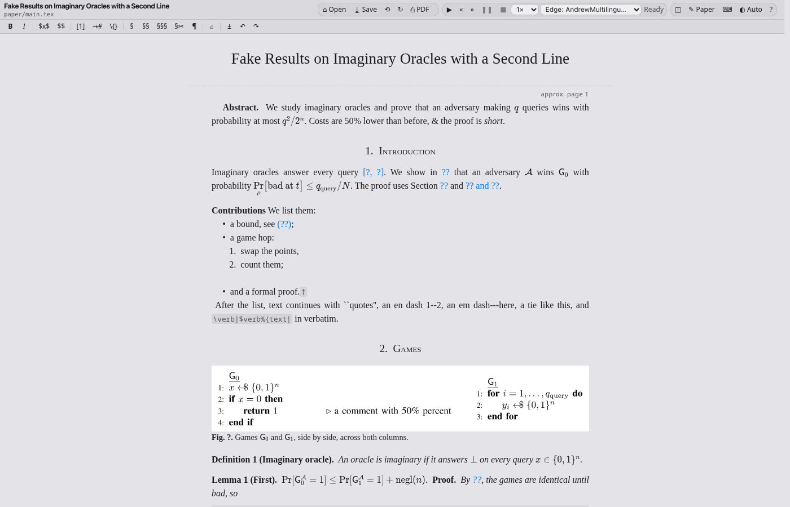
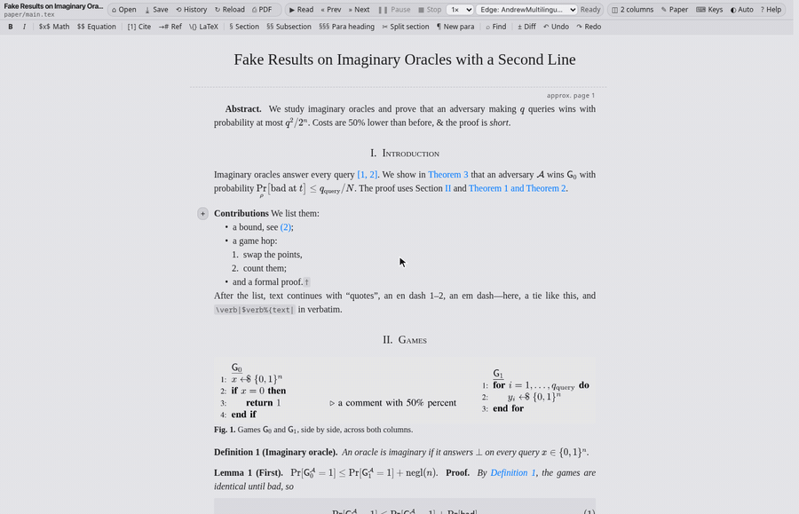
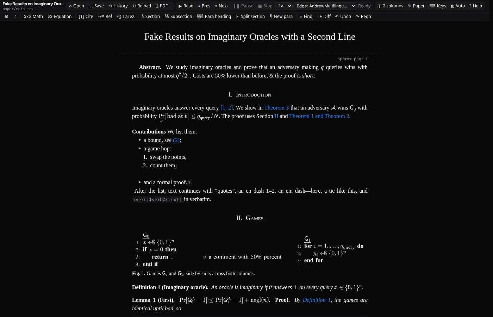

# Crypto Paper Reviewer

Review a LaTeX paper as the paper itself. Your `.tex` sources are shown as the
rendered paper, with typeset maths and the same numbers as the PDF. You fix
things in place, and each save writes back only what you changed, then
rebuilds the PDF. It is made for cryptography papers: security games and
pseudocode (cryptocode, algorithmicx), cryptobib citations, and conversion
between IACR, LNCS, IEEE, ACM and LIPIcs formats.

Type into the paper, make a phrase bold, save: the edit lands in
`sections/intro.tex` as `\textbf{rendered paper}` and the PDF rebuilds.

**[More recordings](docs/demos.md)**: maths, citations, the game editor,
tables, diff, history, venue conversion and more.

Dark theme

> **Vibe-coded.** An AI assistant wrote this for my own papers, to my taste.
> It works for me; it may not work for you. No support, no stability
> promises. The one thing it is tested hard for: saving never changes text
> you did not edit.

## Install

You need Python 3, a TeX installation with `latexmk` (and `pdfcrop`,
`pdftoppm`, `pdftotext` from poppler), and Chrome, Chromium or Firefox.

    git clone https://github.com/JoaoDiogoDuarte/paper-editor.git
    cd paper-editor

That is enough to start. Reading aloud with offline voices is optional:

    python3 -m venv .venv
    .venv/bin/pip install edge-tts piper-tts kokoro-onnx soundfile
    .venv/bin/python get_voices.py        # downloads ~700 MB of voice models

## Use

    ./run ~/papers/my-paper              # a paper folder (finds the main file)
    ./run ~/papers/my-paper/main.tex     # or a main file

It opens in its own browser window and is reachable only from your machine.
**Open…** switches to another paper or another main file in the same folder.
Other options: `--browser chrome` (a normal window), `--browser system`,
`--no-open`, `--port 8766`, `--main other.tex`.

## What you can do

- **Read the paper, not the source.** Everything the main file `\input`s or
  `\include`s, in order, with section, theorem, equation and citation
  numbers taken from LaTeX's own `.aux`, so they match the PDF. Page breaks
  follow the PDF. Light or dark theme, one or two columns.
- **Fix text in place.** Type directly. Maths, references and citations are
  chips you click to edit, with a live preview. Paste plain text, and
  formulas in it (`$…$`, `\[…\]`) become formulas.
- **Cite and reference by searching.** Search your `.bib` files by key,
  title, author or year (cryptobib's 90k entries take about 40 ms), or
  Crossref and arXiv, which add the entry to your `.bib`. Search labels by
  number, type or text.
- **Edit games and tables.** Double-click a figure with `gameenv` or
  `algorithmic` pseudocode to edit it line by line: insert `if`, `while`,
  `for`, `return` and comments, move statements, colour lines, reorder
  games. Double-click a table to edit it cell by cell. **Apply** puts the
  change into the paper; saving writes it to disk.
- **Review changes.** **Diff** shows what changed since the last save or the
  last Git commit. **History** lists every save and can restore one. If a
  file changes on disk (an editor, `git pull`), the paper reloads, and a
  save never overwrites a file that changed since it was read.
- **Convert to another venue.** **Paper…** shows the detected title,
  authors and affiliations and converts the paper to IEEEtran, llncs,
  iacrcc, iacrtrans, acmart, LIPIcs or article, optionally anonymous. See
  [Converting between venues](#converting-between-venues).
- **Listen to it.** Read aloud phrase by phrase, with the phrase
  highlighted and maths read as words. Voices: the browser's, Kokoro and
  Piper (offline), Edge, Azure and Google. Online voices send the text to
  Microsoft or Google.
- **Saving is exact.** Only the blocks you changed are rewritten. Edited
  text follows house rules you can configure (special characters escaped,
  `~` before `\cite`, `--`/`---` dashes, ` `` '' ` quotes), and the editor
  asks before applying them.

## Keys

| Key | Action |
| --- | --- |
| `Ctrl+S` | save |
| `Ctrl+Z`, `Ctrl+Shift+Z` / `Ctrl+Y` | undo, redo |
| `Ctrl+B`, `Ctrl+I`, `Ctrl+Shift+I` | bold, emphasis, italic |
| `$`, `Ctrl+M` | inline maths (the selection becomes a formula) |
| `Ctrl+Shift+M` | displayed equation |
| `(` `)` `[` `]` `{` `}` `"` `'` over a selection | wrap the selection |
| `Enter` / `Backspace` at a paragraph's start | new paragraph / join paragraphs |
| `Ctrl+Alt+1`, `2`, `3` | section, subsection, paragraph heading |
| `Ctrl+Alt+C`, `Ctrl+Alt+R` | cite, reference |
| `Ctrl+\` | insert any LaTeX |
| `Ctrl+F`, `Ctrl+H` | find, find and replace |
| `Ctrl+A`, `Ctrl+E` | start, end of line (`Shift` selects) |
| `Ctrl+D`, `Alt+W`, `Ctrl+P` | delete line, cut, duplicate |
| `Ctrl++` | expand the selection: word, line, paragraph |
| `Alt+R`, `Alt+P`, `Alt+S` | read aloud, pause, stop |
| `Ctrl+Alt+Left`, `Ctrl+Alt+Right` | previous, next sentence |

**Keys** in the toolbar changes them. In the game editor, `Ctrl+Enter`
applies and `Ctrl+S` applies and saves. Spelling: right-click, *Add to
Dictionary*.

## Settings for a paper

Each paper keeps its settings and caches in its own `.paper-editor/` folder.
`.paper-editor/config.json` is optional and worth committing:

    {
      "house_rules": {"tie_before": ["cite", "ref"], "flag_bracketed_cref": true, "one_sentence_per_line": false},
      "key_style": "cryptobib",
      "bib_add_to": "references.bib",
      "build": ["latexmk", "-pdf", "-synctex=1", "main.tex"],
      "code_envs": ["ecblock"]
    }

Metadata you correct in **Paper…** is kept in `.paper-editor/metadata.json`.
It never rewrites your `\author` lines.

## Converting between venues

**Paper…** reads the front matter of IEEEtran, llncs, iacrcc, iacrtrans,
svjour3, acmart, LIPIcs and article papers. It shows what the target class
needs (an ORCID, a country, a licence, …) and writes a new main file under
`converted/<venue>/`, built at once; your section files are reused
unchanged. [docs/styles.md](docs/styles.md) explains what differs between
the classes.

- **Anonymous versions** use the class's own mechanism where there is one,
  drop acknowledgements and the PDF author field, and warn about
  acknowledgements, funding and `\thanks` in other files. Self-citations in
  the first person are yours to check.
- **Class files** that TeX Live does not ship (`iacrcc`, `iacrtrans`,
  `lipics-v2021`, `svjour3`, Springer Nature's `sn-jnl`, with their
  `.bst`/`.clo` files) are bundled in `classes/`. Others must be installed;
  for LNCS use Springer's [llncs package](https://ctan.org/pkg/llncs) (it
  includes `splncs04.bst`).
- **Round trips.** A converted file remembers the file it came from.
  Converting it back gives the original byte for byte, with your edits to
  the converted text carried over; converting it to a third venue starts
  from the original, so no compatibility shims pile up.
- **IACR:** `iacrcc` is a legacy target. IACR now recommends
  [`iacrj.cls`](https://github.com/IACR/latex), which is not supported yet.

## Not done yet

Springer Nature `sn-jnl`, `iacrj` and USENIX targets; a per-paper dictionary.

## Development

Tests, the CI layout and how to debug TeX builds are in
[docs/development.md](docs/development.md).

## License

[MIT No Attribution](LICENSE): do anything with it, no notice required.
