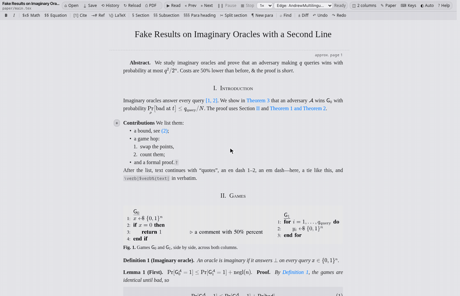
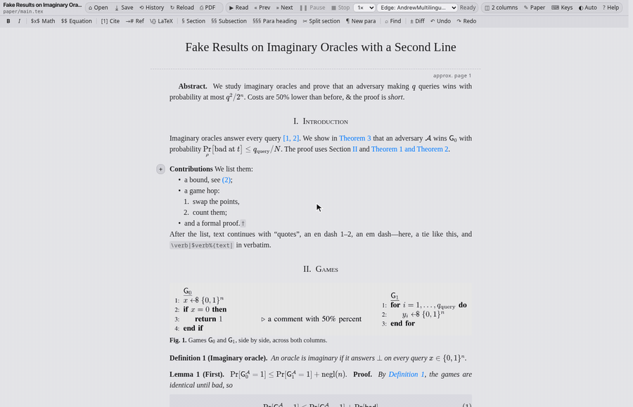
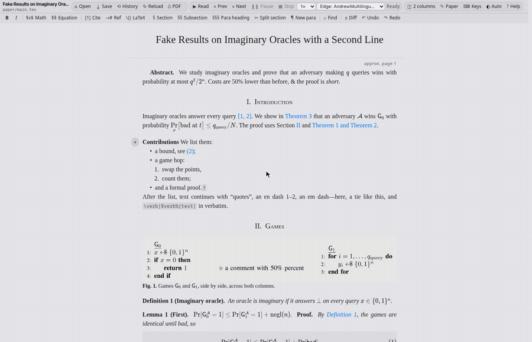
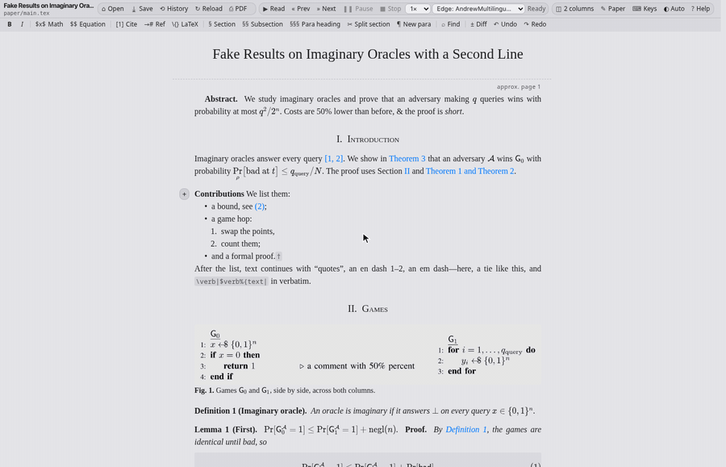

# Demos

Each GIF is the editor driven by a script in headless Chrome on a copy of the
`tests/fixtures/ieee-conf` paper (built first, so references resolve). The
pointer is drawn by the recorder. Numbers are for pointing at one in feedback.

## Editing text

### 1. Type into the rendered paper, bold a phrase, save

### 2. Undo and redo

### 3. Insert an inline formula with $

### 4. Insert a displayed equation

### 5. Insert arbitrary LaTeX

### 6. Insert a citation by searching the bibliography

### 7. Insert a cross-reference by searching labels

### 8. Find and replace across the paper

## Structure

### 9. Add a section heading at the cursor

### 10. Split a section at the cursor

## Figures, games and tables

### 11. Open the game editor on a figure

### 12. Game editor: insert a While block, colour a line, apply

### 13. Edit a table cell by cell

### 14. Undo and redo inside the game, table and formula editors

## Reviewing

### 15. Edit, then show the diff against the last save

### 16. Save, then browse the save history

### 17. The source changes on disk: reload or keep your edits

### 18. Switch to two columns and back

### 19. Scroll through the paper

### 20. Read aloud from the caret (headless: no audio)

## Paper and settings

### 21. Paper metadata and venue conversion

### 22. Convert the paper to LNCS (anonymous) and build it

### 23. Keyboard shortcuts

### 24. Cycle the colour scheme

